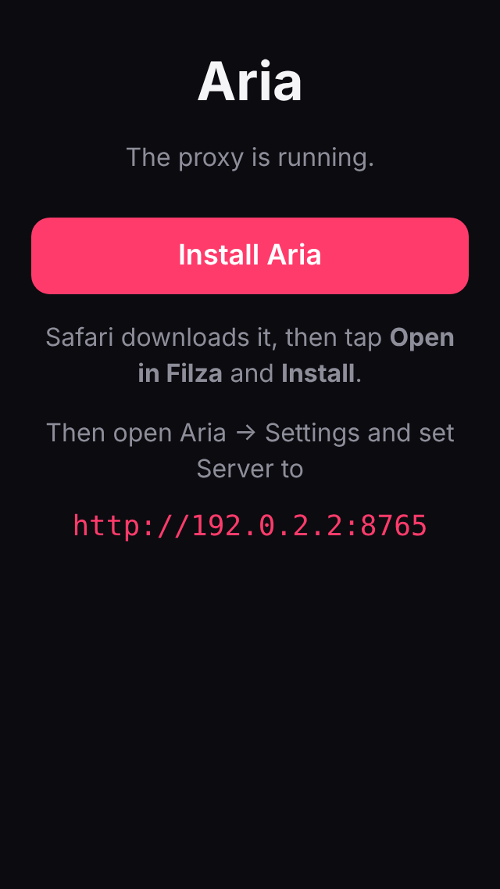

# Aria

> This lives on the `aria` branch of [Aezdek/Randomness](https://github.com/Aezdek/Randomness)
> ("every project that is too small to get a repo gets a branch").

A modern music player for a **jailbroken iPod touch 5th gen** (iOS 9.x). It also runs on other jailbroken
iOS 9+ devices. It plays the music synced to the iPod, and it streams anything from YouTube through a
small server that runs on your computer.

## Features

- **Library**: every song and album synced with iTunes, with search, Shuffle All, and album pages that have Play and Shuffle buttons.
- **Stream**: search YouTube, play results right away, and keep tracks with the heart button. Saved and Recently Played appear on the Stream tab.
- **Now Playing**:
  - The background is a blur of the artwork, and the artwork shrinks when paused.
  - Big transport controls, a scrubber, shuffle and repeat (all or one), a volume slider and an Up Next queue.
  - Swipe down to close it.
- **Mini player** above the tab bar, showing progress, play/pause and next. Tap it or swipe up to open Now Playing.
- **Queue**: long-press any song (or tap **⋯** on a stream result) to Play Next or Add to Queue. Swipe to remove from Up Next.
- **Lock screen and Control Center**: shows the artwork, title and progress, and the controls and headphone buttons work.
- Keeps playing in the background, pauses when headphones are unplugged, and resumes after an interruption.

---

## Install

You need:

- An iPod touch 5th gen on iOS 9 that is **jailbroken** (Phœnix or similar) and has **Filza File Manager** from Cydia.
- A computer (Windows, Mac or Linux) on the **same Wi-Fi**, with **Python 3.9 or newer**.
  - On Windows, get it from [python.org](https://www.python.org/downloads/) and tick **"Add python.exe to PATH"** in the installer.
  - On a Mac, `python3` is there after you run `xcode-select --install`, or install it from python.org.

The computer runs the Aria server. The server streams YouTube to the iPod, and it also hands the iPod the
app to install.

### Step 1: Start the server on your computer

Download this branch: on GitHub, switch to the `aria` branch, then **Code → Download ZIP**, and unzip it.
Or run `git clone -b aria https://github.com/Aezdek/Randomness.git aria`.

Then start the server:

| Windows | Mac / Linux |
| --- | --- |
| Open the `server` folder and double-click **`run.bat`** | In a terminal: `./server/run.sh` |

The first start takes a minute, because it installs yt-dlp and Deno into `server/.venv`. When it's ready, it prints:

```
12:54:23 Aria proxy 1.0.0 (yt-dlp 2026.08.19)
12:54:23 On the iPod, open http://192.168.1.20:8765 in Safari to install Aria
12:54:23 In the app, set Server to: http://192.168.1.20:8765
12:54:24 App package: serving xyz.aezdek.aria_1.0.0_iphoneos-arm.deb (downloaded from aria-v1.0.0)
```

Note **your** address (the `http://192.168.…:8765` part). Leave this window open while you listen.

> **Windows firewall:** the first time, Windows asks whether Python may use the network. Allow it on **Private networks**, or the iPod can't connect.

### Step 2: Install the app on the iPod



1. On the iPod, open **Safari** and go to the address from Step 1, for example `http://192.168.1.20:8765`.
2. Tap **Install Aria**.
3. Safari shows the download. Tap **Open in "Filza"**.
4. Filza shows the package. Tap **Install** in the top right corner.
5. When it finishes, tap **Done**, then press the Home button. **Aria** is on the home screen.
   If it isn't, respring, or run `uicache` in a terminal app.

<br clear="right">

**Other ways to install** (any one works):

- **SSH** (needs OpenSSH from Cydia, default password `alpine`, so change it):
  ```sh
  scp xyz.aezdek.aria_1.0.0_iphoneos-arm.deb root@<ipod-ip>:/tmp/
  ssh root@<ipod-ip> "dpkg -i /tmp/xyz.aezdek.aria_*.deb && uicache"
  ```
- **The `.deb` file directly**: from [Releases](https://github.com/Aezdek/Randomness/releases), or from GitHub → Actions → **Aria** → the latest run → the `aria-deb` artifact.

### Step 3: Connect the app to the server

1. Open **Aria**, then go to the **Settings** tab.
2. Under **YouTube Proxy**, set **Server** to the same address, for example `http://192.168.1.20:8765`.
3. Tap **Test Connection**. It should say **Connected · yt-dlp …**.
4. Go to **Stream** and search for something.

Your synced music is already in the **Library** tab and works without the server.

### Updating and uninstalling

- **Update the app:** open the server page in Safari again and install the newer version over the top.
- **Update the server:** run `run.bat` or `run.sh` again. It updates yt-dlp every time it starts.
- **Uninstall:** in Cydia, go to Installed → Aria → Modify → Remove. Or run `dpkg -r xyz.aezdek.aria` over SSH.

### Troubleshooting

| Problem | Fix |
| --- | --- |
| Safari can't open the server page | Make sure both devices are on the same Wi-Fi and the server window is open. Check the firewall (see Step 1). Some guest or "client isolated" networks block devices from reaching each other. |
| The page says the app package isn't available | The server couldn't download it from GitHub. Download the `.deb` from Releases, put it in the `server` folder, and restart the server. |
| Test Connection says "Wrong or missing access key" | You started the server with `--token`. Enter the same value in Settings → **Key**. |
| Search or playback fails with a YouTube error | Restart the server, which updates yt-dlp. YouTube changes often and old yt-dlp versions stop working. |
| A library song shows dimmed and won't play | It's DRM-protected (an old iTunes Store purchase) or only in iCloud. Third-party apps can't play those. |
| Music stops when the computer sleeps | YouTube streams through the computer. Stop it from sleeping, or run the server on something always on, such as a Raspberry Pi. |

### Server options

```sh
./server/run.sh --port 9000          # use another port
./server/run.sh --token mysecret     # require a key (enter it in the app under Settings → Key)
./server/run.sh --deb path/to.deb    # offer a specific build for install
```

To use it away from home, run the server on a machine you can reach from outside, always with `--token`.

---

## How it works

```
iPod (Aria app)  ──plain HTTP on your Wi-Fi──▶  aria_proxy.py on your computer  ──HTTPS──▶  YouTube
```

iOS 9 can't do the TLS YouTube needs and can't run yt-dlp. The proxy does that work. It sends the iPod
128 kbps AAC (`.m4a`), which iOS 9 plays natively, and supports byte ranges so seeking works.
Thumbnails go through the proxy too. Local songs play straight from the iPod.

| Endpoint | What it does |
| --- | --- |
| `GET /` | Install page for the iPod's Safari |
| `GET /aria.deb` | The app package |
| `GET /api/ping` | Server and yt-dlp version |
| `GET /api/search?q=…` | YouTube search results |
| `GET /stream/<id>.m4a` | Audio, with Range support |
| `GET /thumb/<id>.jpg?size=small\|large` | Thumbnails |

## Building the app

The app is Objective-C for iOS 9 and is built with [Theos](https://theos.dev) on Linux, macOS or WSL. CI
builds it on every push to `aria` and publishes it as the release `aria-v<version>`. To make a new
release, bump `Version:` in `app/control`. The server downloads the newest release automatically.

```sh
# One time: Theos, an iOS toolchain, and the iOS 12.4 SDK (the newest one that still has armv7)
export THEOS=~/theos
git clone --recursive https://github.com/theos/theos.git $THEOS
mkdir -p $THEOS/toolchain && curl -sSL https://github.com/L1ghtmann/llvm-project/releases/latest/download/iOSToolchain-x86_64.tar.xz | tar -xJ -C $THEOS/toolchain
git clone --depth 1 --filter=blob:none --sparse https://github.com/theos/sdks.git /tmp/sdks
git -C /tmp/sdks sparse-checkout set iPhoneOS12.4.sdk && mv /tmp/sdks/iPhoneOS12.4.sdk $THEOS/sdks/

cd app
make package FINALPACKAGE=1                   # → packages/xyz.aezdek.aria_<version>_iphoneos-arm.deb
make package install THEOS_DEVICE_IP=<ipod>   # build and install over SSH
```

The build targets iOS 9.0 (armv7 + arm64) with `-Wunguarded-availability`, so the compiler rejects any
API newer than iOS 9. To change the icon or launch images, edit `app/tools/make_images.py` and run it (it needs Pillow).

| Path | What it is |
| --- | --- |
| `server/aria_proxy.py` | The server: YouTube search, audio relay, thumbnails, install page. |
| `server/run.sh`, `server/run.bat` | One-command setup and start. |
| `app/Sources/ARPlayer.*` | Playback engine: one `AVPlayer` for local and stream, queue, shuffle, repeat, lock screen, remote commands, interruptions. |
| `app/Sources/ARProxyClient.*` | Talks to the server. |
| `app/Sources/ARLibraryViewController.*`, `ARAlbumViewController.*` | Local music. |
| `app/Sources/ARStreamViewController.*` | YouTube search, Saved, Recently Played. |
| `app/Sources/ARNowPlayingViewController.*`, `ARMiniPlayerView.*`, `ARQueueViewController.*` | Player UI. |
| `app/Sources/ARIcons.*`, `ARTheme.*` | Icons drawn in code, plus colors and fonts. |
